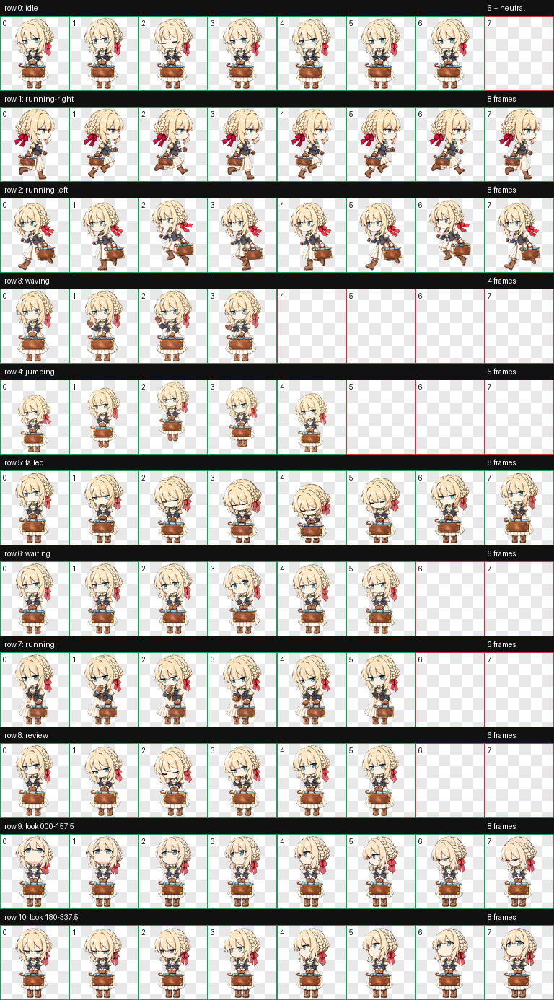
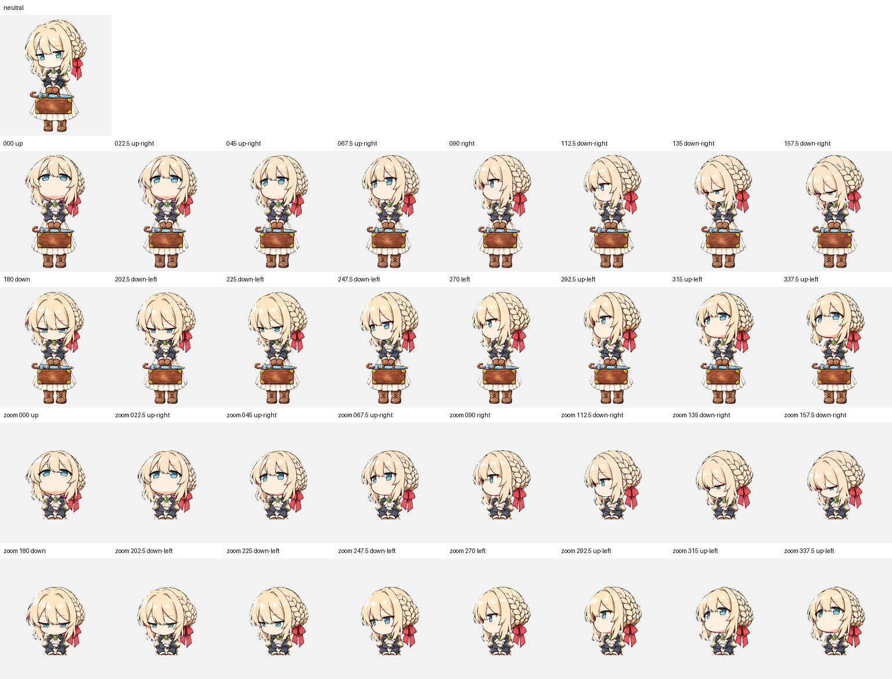

# Violet Evergarden Codex Pet v3

An unofficial, fan-made animated Codex pet inspired by Violet Evergarden. This revision uses compact chibi proportions, a smaller brown suitcase, and a shortened folded pale-blue parasol.

这是一个非官方的薇尔莉特 Codex 动画宠物。v3 采用紧凑的 Q 版身体比例，并缩小了棕色皮箱和收起的浅蓝色阳伞。



## Features

- Codex sprite format v2
- 1536 x 2288 transparent WebP atlas
- 9 standard animation states
- 16 clockwise look directions
- Validated 8 x 11 sprite layout

## Install

### Windows

1. Download this repository with **Code -> Download ZIP**.
2. Extract the ZIP.
3. Rename the extracted folder to `violet-evergarden-chibi-prop-v3`.
4. Copy it into `%USERPROFILE%\.codex\pets\`.
5. Confirm `pet.json` and `spritesheet.webp` are directly inside the folder.
6. Restart Codex and select the pet.

### macOS or Linux

Place the repository folder at:

```text
$HOME/.codex/pets/violet-evergarden-chibi-prop-v3
```

Then restart Codex.

## Preview



Individual animation previews are available in [`docs/previews`](docs/previews).

## Validation

The packaged atlas passes the local Codex v2 atlas validator with no errors or warnings. See [`qa/validation.json`](qa/validation.json).

SHA-256 checksums are listed in [`SHA256SUMS.txt`](SHA256SUMS.txt).

## Notice

This repository is an unofficial fan project and is not affiliated with or endorsed by the creators, publishers, or rights holders of *Violet Evergarden*. See [`NOTICE.md`](NOTICE.md). No open-source license is included.
